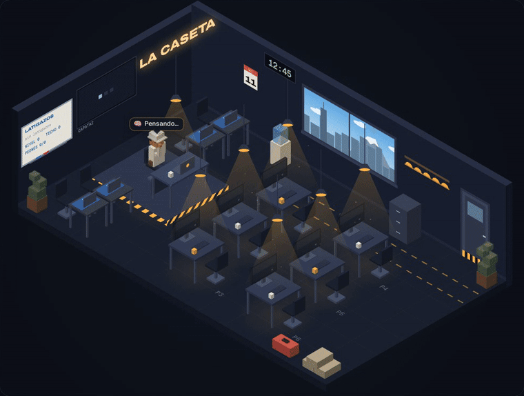

<p align="center"></p>

# Chambeadores

**Oficina virtual con látigo.**

Cuando una tarea larga se puede partir, le das un latigazo al capataz (tu sesión de Claude Code) y él reparte lo que falta entre **peones** (subagentes) que trabajan en paralelo, cada uno en su propio worktree de git.

Mientras tanto, **la caseta**, una oficina de obra en el turno de noche, te enseña en vivo qué hace cada uno: si piensa, qué archivo lee o edita, qué comando corre, si te pide permiso y cuándo termina. Mirar la caseta no gasta tokens.

**[Pruébala en el navegador](https://samaelfl.github.io/Chambeadores/?demo)**: es la demostración, no necesita instalar nada. Agarra el látigo con el mouse y suéltale un chicotazo al capataz.

## Instalar

Necesitas Claude Code 2.1.198 o más nuevo (desde ahí los subagentes corren en segundo plano) y Python 3.8 o más nuevo, sin dependencias. Para la ventana flotante, Chrome o Edge.

```bash
# macOS / Linux
python3 instalar.py

# Windows (PowerShell)
py instalar.py
```

Luego **reinicia Claude Code**. La caseta se abre sola la siguiente vez que arranque.

El instalador revisa que tu `~/.claude/settings.json` sea JSON válido antes de copiar nada, lo respalda en `~/.claude/latigo-respaldos/` y conserva los hooks que ya tengas. Si es un enlace a tus dotfiles, escribe en el archivo real y el enlace se queda. También pone `worktree.baseRef` en `"head"` si no lo tenías, para que los peones arranquen desde tu último commit y no desde `main`. Con `--sin-baseref` no lo toca.

## Usar

**Dar un latigazo** (le llega al capataz en cuanto termine la herramienta que está usando):

- En la caseta: haz clic en el capataz, arrastra el látigo y suéltale un chicotazo, presiona `L` o usa el botón **Dar latigazo**.
- En la terminal de Claude Code: escribe `latigazo` como mensaje normal, solo o con una nota (`latigazo: apúrate con las pruebas`); llega a media tarea. Una frase que nada más menciona el látigo no cuenta. `/latigo` también funciona, pero Claude Code guarda los comandos hasta que termina el turno.

**Reglas del látigo:**

| Latigazo efectivo | Techo de peones |
|---|---|
| 1.º | 3 |
| 2.º en adelante | 5 (tope) |

- Entre latigazos efectivos hay 60 s de calma. Si latigueas antes, solo suena.
- Si hay peones trabajando, otro latigazo solo suena.
- Si el capataz está esperando tus instrucciones, el latigazo solo suena.
- Un latigazo desde la caseta le llega al capataz cuando termina la herramienta que está usando. Si no le llega en 10 minutos, o le das un encargo nuevo antes, se cancela y no cuenta.
- El capataz decide si conviene repartir y cuántos peones manda, sin pasar del techo. Si la tarea es una cadena o un solo bug, dice "esto no se paraleliza" y sigue solo.

**Una vez por proyecto:** escribe `/latigo init` en Claude Code. Crea la ficha `.claude/latigo.md` (stack, skills que aplican, comandos de verificación, qué no se toca) y a cada peón le llega al arrancar. Detecta Angular, React/Vite, Next, Node, Maven/Spring, Gradle, Python, Go y Rust. La ficha no lleva rutas de tu máquina, así que sirve igual en macOS, Linux y Windows. Si lo aceptas después de ver la lista, también deja pre-autorizados en `.claude/settings.local.json` `git add/commit`, los comandos exactos de verificación que dice la ficha (ya corregida) y la limpieza de las ramas de los peones (`worktree-agent-…`). Las variantes destructivas (`--force`, `-D`, `--amend`) siempre te preguntan. Esto importa: los peones corren en segundo plano y **cada permiso que pidan te llega a la sesión principal**.

## Qué ves en la caseta

| En la caseta | Qué está pasando |
|---|---|
| Mano en la barbilla y globo "Pensando…" | El modelo está generando; el texto del razonamiento no se puede ver |
| Teclea; el monitor muestra código de colores | Edita o escribe un archivo (con +líneas −líneas) |
| Teclea; el monitor muestra letras verdes | Corre un comando (se ve su descripción o el comando) |
| Hoja de papel o línea amarilla que baja | Lee o busca en el código |
| Página web en el monitor | WebFetch o WebSearch |
| Mano levantada y globo con borde ámbar que late | **Te está pidiendo permiso** o te hizo una pregunta |
| Globo de diálogo | Lo que acaba de contestar |
| Pulgar arriba y luego se va por la puerta | Un peón terminó |
| Zzz | Lleva rato esperándote |

El capataz es el del casco blanco, en la tarima; lo que hace se ve también en la pantalla grande de la pared. El **Topógrafo** es el subagente Explore y el **Arquitecto**, Plan. El pizarrón lleva la cuenta de los latigazos y el perchero, los cascos disponibles. La ventana muestra el cielo de la ciudad a tu hora real. En el panel (los "planos") tienes cada sesión en su pestaña, la cuadrilla con su contexto y tokens, y la **bitácora de obra**.

## Costo

- **La caseta: cero tokens.** Solo lee eventos de hooks y los transcripts que Claude Code ya escribe en tu disco.
- **Un latigazo:** el aviso cuesta unos 100 tokens y la skill alrededor de 1,500 la primera vez.
- **Los peones:** cada peón es una sesión aparte con Sonnet (el más nuevo; hoy, Sonnet 5.5), aunque el capataz use Opus. Para cambiarlo, edita `model:` en `plantillas/agentes/peon.md` y `peon-libre.md` (`inherit` = el mismo que el capataz) y vuelve a correr el instalador. En total gastas más tokens, porque cada uno vuelve a leer lo que necesita, y a cambio terminas antes. Por eso el techo existe y por eso latiguear de más solo hace ruido.

## Comandos

```bash
python3 ~/.claude/latigo/latigo.py abrir         # abre la caseta
python3 ~/.claude/latigo/latigo.py demo          # demostración (no necesita Claude Code)
python3 ~/.claude/latigo/latigo.py init          # ficha del proyecto (--permisos, --forzar)
python3 ~/.claude/latigo/latigo.py estado        # qué sesiones ve la oficina
python3 ~/.claude/latigo/latigo.py diagnostico   # revisa la instalación
python3 ~/.claude/latigo/latigo.py parar         # apaga la oficina
```

Para escribir solo `latigo`:

- **macOS (zsh):** `echo 'alias latigo="python3 ~/.claude/latigo/latigo.py"' >> ~/.zshrc`
- **Windows (perfil de PowerShell):** `function latigo { py "$env:USERPROFILE\.claude\latigo\latigo.py" @args }`

La configuración está en `~/.claude/latigo/config.json`: puerto, techos, calma, sonidos, volumen, si la caseta se abre sola y las skills que `init` sugiere por stack. Los sonidos se sintetizan al instalar: latigazo, peón listo, permiso, turno largo terminado y error. Se apagan con la bocina o desde ⚙.

## Desinstalar

```bash
python3 instalar.py --desinstalar
```

Quita los hooks del látigo, la skill, los peones y `~/.claude/latigo/`. Si al instalar había reemplazado una skill o un agente tuyo con el mismo nombre, lo restaura. Los respaldos se quedan en `~/.claude/latigo-respaldos/`.

## Cómo funciona

```
Claude Code ─ hooks (19) ─► hook.py ─ UDP ─► oficina (127.0.0.1:47821) ─ SSE ─► la caseta
     │                                        ▲
     └─ transcripts JSONL (texto, tokens) ────┘

clic en el capataz ─► oficina ─► latigazo pendiente ─► siguiente PostToolBatch/Stop del capataz
   ─► aviso como contexto ─► skill latigo ─► N peones (worktrees) ─► merge ─► verificación ─► limpieza
```

- **Telemetría:** son hooks `async`; no hacen esperar a Claude.
- **Control:** son hooks síncronos de unos 20 ms (`PostToolBatch`, `Stop`, `UserPromptSubmit`, `Skill`, `SubagentStart` de peones). Solo imprimen algo cuando hay latigazo o ficha que entregar.
- **Oficina:** escucha solo en `127.0.0.1` y exige un Host local. La API (estado, eventos y todo lo que cambia algo) exige el token de tu instalación, que vive en `estado/token`. El token no viaja en ninguna URL: la ventana se abre con un boleto de un solo uso que la caseta canjea por él. Sobrevive a los reinicios, así que una caseta abierta se reconecta sola.
- **Hooks:** nunca salen con error hacia Claude Code.

Más detalle, con fuentes, en [docs/INVESTIGACION.md](docs/INVESTIGACION.md).

## Problemas comunes

- **No aparece nada en la caseta:** reinicia Claude Code (los hooks se leen al arrancar) y corre `diagnostico`.
- **La caseta dice que no está conectada:** la abriste sin su llave (por ejemplo, escribiendo la dirección a mano en otro navegador). Ábrela con `latigo abrir`.
- **Windows abre la Microsoft Store al escribir `python`:** instala Python de python.org y vuelve a correr el instalador con `py`.
- **Los peones no ven mis cambios:** su worktree sale de tu último commit. El capataz hace un commit `latigo: checkpoint` antes de repartir; si no lo quieres, pon `checkpoint: no` en la ficha.
- **Muchos permisos de los peones:** acepta `--permisos` en `/latigo init` o usa el modo automático.
- **Detrás de un proxy:** no descarga nada y las llamadas a `127.0.0.1` no pasan por el proxy.

## Pruebas

```bash
python3 -m unittest discover -s pruebas -v
```

## Créditos

Inspirado en [badclaude](https://github.com/fffonion/badclaude). Tipografías: Archivo y Geist, con licencia SIL Open Font License (en `latigo/web/fuentes/`). Licencia del código: MIT.
